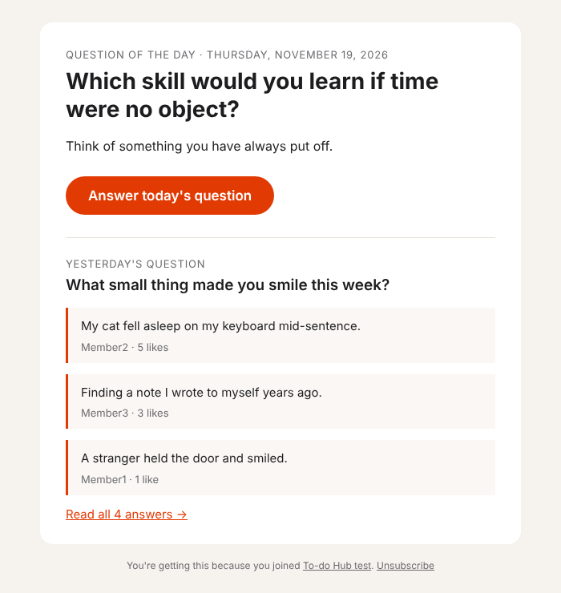
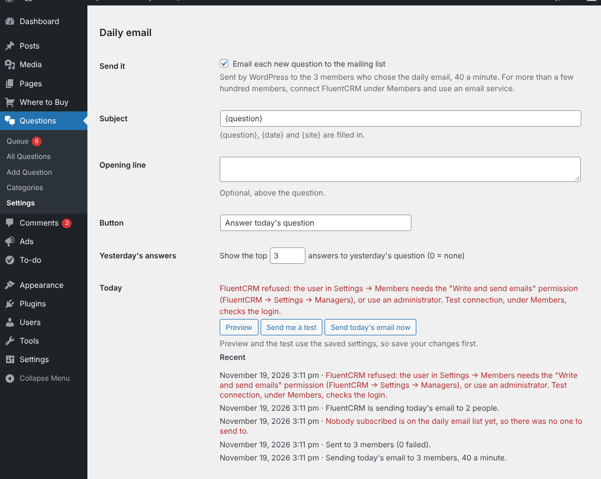

# Daily email

Each new question is emailed to your list about a minute after it goes up, once per question day.

## Turning it on

In **Settings → Daily email**, tick **Email each new question to the mailing list**. Automatic emails start with the *next* question, so nobody gets a surprise email in the middle of the day. To send today's straight away, use **Send today's email now**.

## How it's sent

**With FluentCRM** (on this site or another, set under [Members](members-and-mailing-list.md)), each email is a FluentCRM campaign:

- It goes to your daily email lists, to subscribed contacts only.
- FluentCRM adds its footer and unsubscribe link, sends through your email service, and reports opens and clicks under **FluentCRM → Email Campaigns**.
- With FluentCRM on another site, the user needs FluentCRM's *Write and send emails* permission.
- If a try fails partway through, the next try finishes the same draft campaign instead of making a second one.

**Without FluentCRM**, the built-in sender emails members who chose the daily email:

- It sends 40 a minute through WordPress's own email, which uses your SMTP or email-service plugin if you have one.
- Each email has an unsubscribe link, plus the one-click unsubscribe headers that mail apps use for their own Unsubscribe button.
- It's fine for a few hundred members. For more, use FluentCRM with a proper email service (Amazon SES, Brevo, Postmark…), and set up SPF, DKIM and DMARC on your sending domain.

## What's in it

- Your **opening line**, if you set one.
- The question with its date, and its background.
- A button (default: *Answer today's question*) that goes to the answers.
- The **top answers to yesterday's question**: the three most-liked by default, or set 0 for none.

The **subject** is `{question}` by default; `{date}` and `{site}` work too. For the built-in sender you can set the **From** name and address. Use an address on your own domain so the email isn't marked as spam.

With FluentCRM, the email uses FluentCRM's own sender settings unless you fill in **FluentCRM sender**: a name (such as your site's name), the address it comes from and, if replies should go elsewhere, a reply-to. FluentCRM needs the name and the address together; with only a name it falls back to its default sender. Use an address your FluentCRM site is set up to send from. This only changes the daily email, not your other FluentCRM campaigns.

## Checking it

- **Preview** shows the email in your browser.
- **Send me a test** sends it to you. With FluentCRM, the real email has FluentCRM's footer instead of the plugin's.
- **Today** shows whether today's email went, to how many people, and recent results.

If sending fails, it's tried again on the hourly check (up to five times, half an hour apart), and To-do Hub gets a task until it works.
