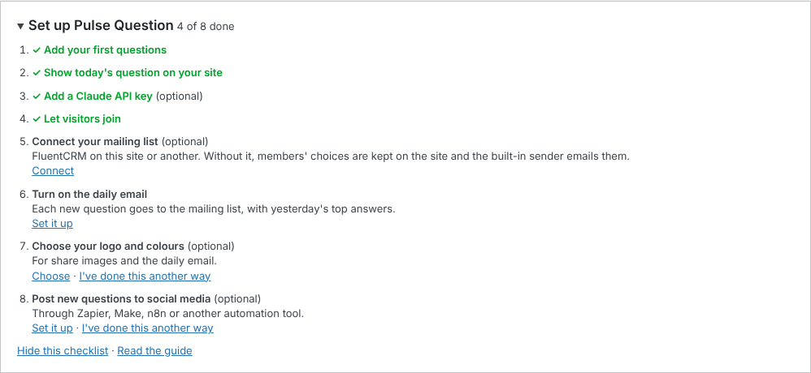

# Getting started

Pulse Question needs WordPress 6.4 or later and PHP 8.1 or later.

## Install

1. Download `pulse-question-x.y.z.zip` from the [latest release](https://github.com/bignall/pulse-question/releases/latest).
2. In WordPress, go to **Plugins → Add New → Upload Plugin**, choose the zip, and activate it.
3. A notice leads you to **Questions → Settings**. The checklist at the top of that page walks you through the rest.

## The setup checklist

Each step is ticked as soon as it's done. For steps the plugin can't see (for example, showing the question with a page builder), use **I've done this another way**. Steps marked *optional* aren't needed for the basics. When you no longer need the checklist, use **Hide this checklist**.

1. **Add your first questions.** In **Questions → Queue**, type them one per line. See [Questions](questions.md).
2. **Show today's question on your site.** Use **Create a page with today's question and past questions** at the bottom of Settings, and tick *make it the home page* if the site is all about the question. Or add the *Question of the day* and *Past questions* blocks anywhere. See [Branding and design](branding-and-design.md) for page builders.
3. **Add a Claude API key** (optional). With it, Claude writes questions and checks every answer. Without it, you write the questions and every answer waits for you.
4. **Let visitors join.** Answering needs an account. In **Settings → General**, turn on *Anyone can register* and set *New User Default Role* to *Subscriber*.
5. **Connect your mailing list** (optional). Use FluentCRM on this site or another. See [Members and mailing list](members-and-mailing-list.md).
6. **Turn on the daily email.** See [Daily email](daily-email.md).
7. **Choose your logo and colours** (optional). See [Branding and design](branding-and-design.md).
8. **Post new questions to social media** (optional). See [Social sharing](social-sharing.md).

## When the question changes

Set the time under **Settings → General → New question each day at**, in your site's time zone. The new question goes up on the first visit or hourly check after that time, so it doesn't depend on WP-Cron running exactly on time.

For a reliable hourly check, have your host call `wp-cron.php` every few minutes (on SiteGround: *Site Tools → Devs → Cron Jobs*), and add `define( 'DISABLE_WP_CRON', true );` to `wp-config.php`.

## Works with To-do Hub

If [To-do Hub](https://github.com/bignall/todo-hub) is active, Pulse Question adds tasks when something needs you, and marks them done when it's sorted:

- the queue is running low;
- questions are waiting for approval;
- answers are waiting for review;
- the daily email or a social post failed.

Turn this off under **Settings → General → To-do list**.
