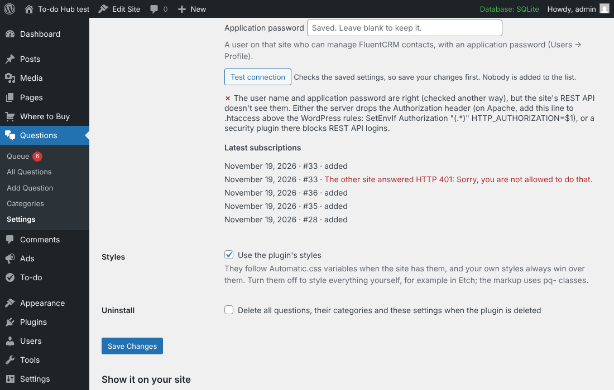

# Members and mailing list

## Joining

Visitors sign up on WordPress's own registration page, which gets two extra boxes:

- **Send me the question of the day by email**
- **Also send me occasional news and offers**

Both are ticked to begin with, and neither is required. Members who signed up some other way see the same boxes once, with their first answer. If they untick both, they aren't asked again. You can change both labels, or leave the second one empty to hide it.

**In the EU and UK, a pre-ticked box doesn't count as consent.** If you have visitors there, turn off **Tick both boxes to begin with**. Double opt-in (below) helps either way.

## Where members go

Under **Settings → Members and mailing list**, choose one:

- **Not connected yet:** each member's choice is kept on the site, and the [built-in sender](daily-email.md) emails those who chose the daily email.
- **FluentCRM on this site:** contacts are added straight to FluentCRM.
- **FluentCRM on another site:** contacts are sent to that site's FluentCRM through its REST API. Use this when your mailing list lives on a different WordPress site.

Then set:

- **List ids:** the FluentCRM list(s) for the daily email.
- **Marketing list ids:** added when a member ticks the news-and-offers box.
- **Tag ids:** added to every contact, for example to record where they signed up.

The numbers are on **FluentCRM → Lists** and **Tags**.

With **double opt-in** on (the default), new contacts are *pending* until they click the link in FluentCRM's confirmation email. Only confirmed contacts get mail.

If a sign-up can't be sent (say the other site is down), it's tried again every hour. **Latest subscriptions** in Settings shows recent results.

## FluentCRM on another site

On the FluentCRM site:

1. Choose the user Pulse Question will act as. An administrator works. Otherwise, under **FluentCRM → Settings → Managers**, give the user:
   - **Add, update and import contacts**
   - **Create and update tags, lists, companies and segments**: needed to add contacts to lists and tags.
   - **Write and send emails**: needed for the [daily email](daily-email.md).
2. Under **Users → Profile** for that user, create an **application password**. It's a special password for apps, not their normal one.

Back on your Pulse Question site, enter the other site's address (exactly as it appears in the browser, with `https://`), the user name and the application password, and save.

## Test connection

**Test connection** checks the saved settings one step at a time. It says which step failed and what to do, and adds nobody to the list.

| It says | What to do |
|---|---|
| The address redirects to … | Use the address it suggests. Redirects (http → https, or adding www) drop the login. |
| The site refused the user name or application password | Make a new application password for that user and paste it in. A normal login password won't work. |
| The details are right, but the REST API doesn't see them | The server is dropping the login header, or a security plugin blocks REST API logins. On Apache, add `SetEnvIf Authorization "(.*)" HTTP_AUTHORIZATION=$1` to `.htaccess`, above the WordPress rules. |
| Application passwords look switched off | The site isn't on https://, or a security plugin turned them off. |
| Logged in, but not allowed to use FluentCRM | Give the user the permissions above. |
| FluentCRM isn't active on that site | Activate it, or check the address. |
| List id … isn't in FluentCRM | Use one of the ids it lists. |
