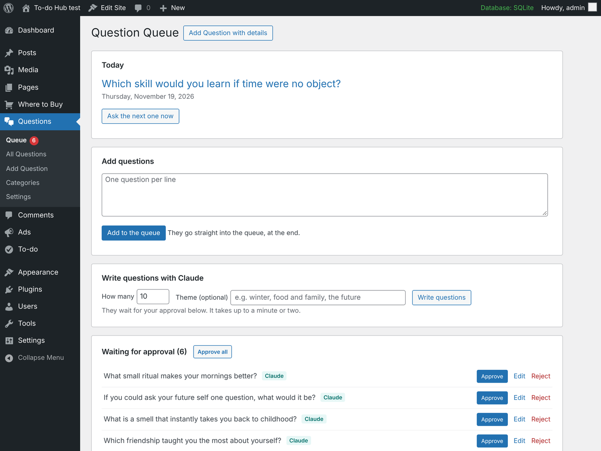

# Questions



## The queue

**Questions → Queue** is where you'll spend most of your time.

- **Add questions** one per line. Your own questions go straight into the queue unless you turn off **Settings → Approval**.
- **Waiting for approval** lists questions that need a yes or no (Claude's, by default). You can *Approve*, *Edit* or *Reject* each one, or *Approve all*.
- **Drag** queued questions to reorder them. Each shows the day it will be asked.
- **Ask the next one now** replaces today's question straight away.
- **Add Question with details** opens the full editor, for a background note, a category or a featured image.

## How a question moves along

Draft → waiting for approval → approved (in the queue) → asked.

A question only appears on the site once it has been asked. Every approved question is asked once, in queue order. When the queue is empty, the question asked longest ago is asked again, and never the same one two days in a row. So the site always has a question, and you get a To-do Hub task to add more.

## Background and categories

The editor's content becomes the question's **background**. It's a line or two shown under the question, in the daily email, and as the share description.

**Categories** (**Questions → Categories**) group past questions. Visitors can browse them, and the past-questions block can show a single category.

## Questions written by Claude

Add an [Anthropic API key](https://platform.claude.com/settings/keys) under **Settings → Questions written by Claude**. To keep the key out of the database, put it in `wp-config.php` instead:

```php
define( 'PULSE_QUESTION_ANTHROPIC_API_KEY', 'sk-ant-...' );
```

- **On demand:** in the Queue, use **Write questions with Claude**. Choose how many, and give a theme if you like (for example "winter", or "food and family").
- **Automatic top-up:** when the queued and waiting questions cover fewer days than you set (14 by default), the hourly check writes a batch (10 by default). It runs at most once every 6 hours, and waits longer after a failure.
- **Approval:** Claude's questions wait for you, marked *Claude*, unless you turn on *Approve Claude's questions straight away*.
- **Guidance:** an editable brief. The default asks for a big variety of everyday, reflective and playful questions, with politics only on rare occasions.
- **What's sent:** the guidance, your category names and the titles of your latest 300 questions, so Claude doesn't repeat itself. Repeats are left out anyway.
- **Model:** Claude Opus 5.5 at medium effort by default. You can change both. Recent batches and their token counts are listed in Settings.
