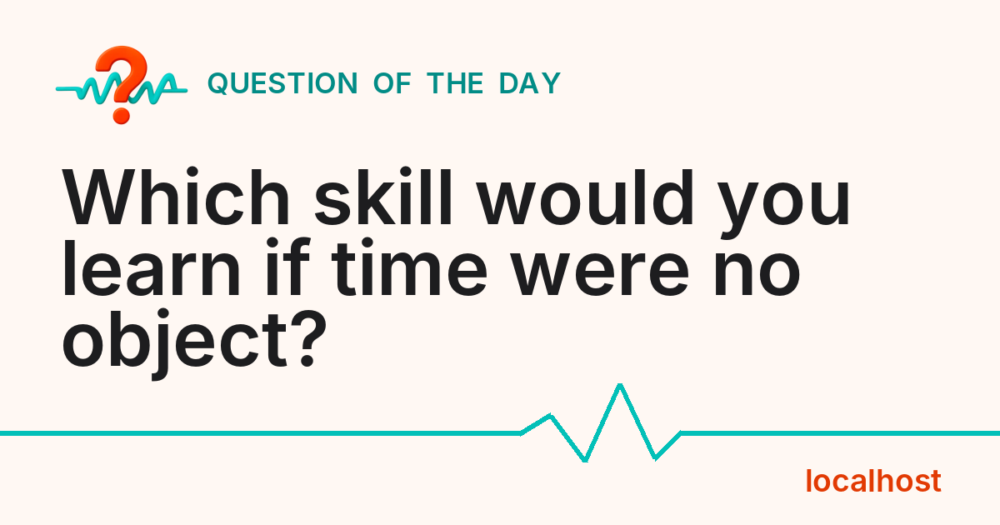
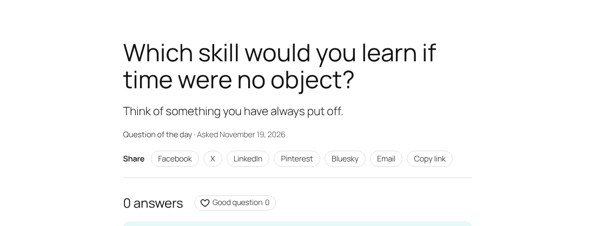
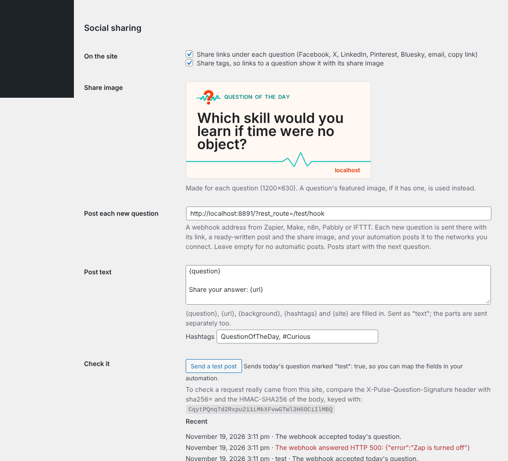

# Social sharing

## Share images

Every question gets a 1200×630 image, the size Facebook, LinkedIn, X and others show best. It has your logo, the label, the question and your site's address.



Images are made with PHP's GD library the first time they're needed, and saved in `wp-content/uploads/pulse-question/share/`. Edit the question, or change your logo or colours, and a new image is made. If a question has a featured image, that's used instead. Emoji are left out, because the font can't draw them.

## Share tags

Question pages get Open Graph and X card tags, so a shared link shows the question, its background and the image. If Yoast SEO or Rank Math is active, it writes the tags and Pulse Question gives it the share image. With other SEO plugins, Pulse Question leaves the tags to them.

## Share links

Under each question there are links for Facebook, X, LinkedIn, Pinterest (with the image), Bluesky and email, plus **Copy link**. On phones there's also a **Share…** button that opens the phone's own share sheet.

These are plain links: nothing is loaded from those sites, and no tracking happens, until someone clicks. Turn them off in **Settings → Social sharing**.



## Automatic posts

Pulse Question posts through an automation tool you already use, rather than to each network directly (their APIs need approved developer apps). Each new question is sent to a webhook address, and your automation posts it wherever you connect: Facebook, Instagram, LinkedIn, X, Bluesky, Threads, Pinterest, Buffer and so on.

1. In Zapier, Make, n8n, Pabbly or IFTTT, start a new automation with a **webhook** trigger (*Catch Hook* in Zapier, *Custom webhook* in Make) and copy its address.
2. Paste the address into **Settings → Social sharing → Post each new question**, and save.
3. Press **Send a test post**, so your automation sees an example and you can map the fields.
4. Add the steps that post to your networks. Use `text` as the post and `image_url` as the image.

Posts start with the next question. A failed post is tried again hourly (up to five times), and To-do Hub gets a task until it works.



### What the webhook receives

```json
{
  "event": "question_of_the_day",
  "test": false,
  "date": "2026-11-19",
  "question": "Which skill would you learn if time were no object?",
  "background": "Think of something you have always put off.",
  "url": "https://example.com/question/which-skill/",
  "text": "Which skill would you learn if time were no object?\n\nShare your answer: https://example.com/question/which-skill/\n\n#QuestionOfTheDay",
  "hashtags": ["#QuestionOfTheDay"],
  "category": "Growth",
  "image_url": "https://example.com/wp-content/uploads/pulse-question/share/q42-1a2b3c4d5e.png",
  "image_width": 1200,
  "image_height": 630,
  "image_alt": "Which skill would you learn if time were no object?",
  "instagram_image_url": "https://example.com/wp-content/uploads/pulse-question/share/q42p-1a2b3c4d5e.jpg",
  "instagram_text": "Which skill would you learn if time were no object?\n\nShare your answer at example.com (link in bio).\n\n#QuestionOfTheDay",
  "site": { "name": "Example", "url": "https://example.com/" }
}
```

For **Instagram**, use `instagram_image_url` and `instagram_text`. Instagram only takes JPEG images, so this is a separate 1080×1350 portrait JPEG (Instagram's tallest feed shape), made from the same design. Links in Instagram captions can't be clicked, so `instagram_text` says to use the link in your bio instead of including the address. In Make, use **Instagram for Business → Create a Photo Post**; the Instagram account must be a professional account linked to your Facebook Page.

`text` comes from the **Post text** template. Its placeholders are `{question}`, `{url}`, `{background}`, `{hashtags}` and `{site}`.

### Checking a request came from your site

Each request carries an `X-Pulse-Question-Signature` header. It's `sha256=` followed by the HMAC-SHA256 of the request body, keyed with the secret shown in Settings. Compute the same on your side and compare.
